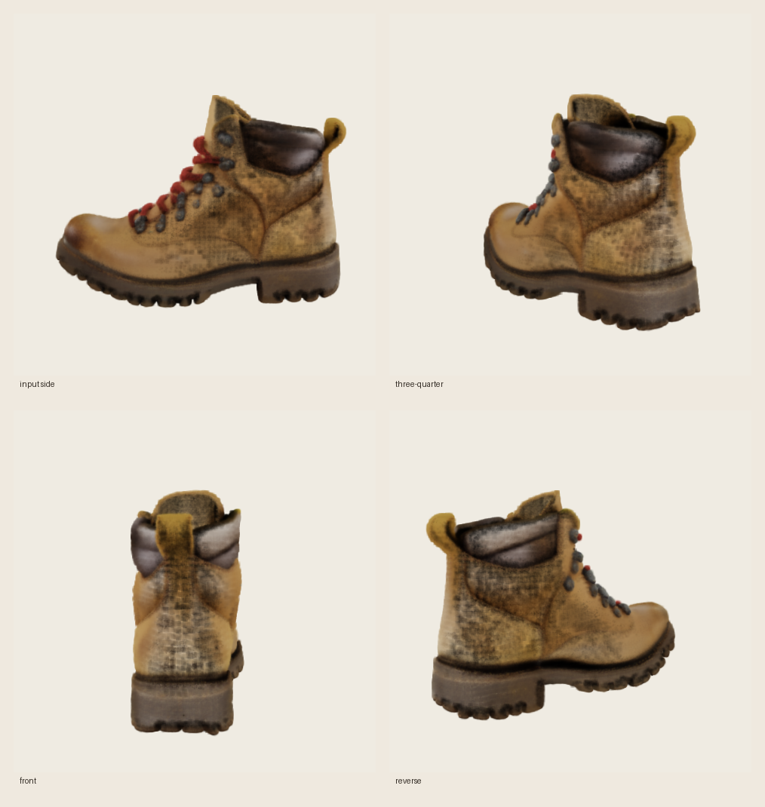

# mlx-diffuser

**Modelos de difusión y flujo en Apple silicon, impulsados por [MLX](https://github.com/ml-explore/mlx).**
Entrena desde cero, realiza ajuste fino o ejecuta inferencia: para imágenes, vídeo, 3D y modalidades discretas, todo desde una base de código pequeña y legible.

[](https://pypi.org/project/mlx-diffuser/)
[](https://pypi.org/project/mlx-diffuser/)
[](https://pypi.org/project/mlx-diffuser/)
[](https://github.com/amirhossein-razlighi/mlx_diffuser/blob/main/LICENSE)
[](https://github.com/amirhossein-razlighi/mlx_diffuser/actions/workflows/ci.yml)
[](https://amirhossein-razlighi.github.io/mlx_diffuser/)

---

<table>
<tr>
<td align="center"></td>
<td align="center"></td>
</tr>
<tr>
<td align="center"><sub><em>"un zorro rojo trotando por la nieve, cinematográfico"</em></sub></td>
<td align="center"><sub><em>"un panda surfeando una gran ola al atardecer, cinematográfico"</em></sub></td>
</tr>
</table>

**WAN 2.1 (1.3B) de texto a vídeo, generado de extremo a extremo en MLX en Apple silicon** — vea la
[guía de WAN](https://amirhossein-razlighi.github.io/mlx_diffuser/guides/wan/).

<table>
<tr>
<td align="center"></td>
<td align="center"></td>
</tr>
<tr>
<td align="center"><sub><em>SDXL base — 1024×1024</em></sub></td>
<td align="center"><sub><em>FLUX.1-schnell — 1024², 4 pasos, 4-bit</em></sub></td>
</tr>
</table>

<p align="center"><sub><em>"un majestuoso león de pie en un acantilado al atardecer, fotorrealista, cinematográfico"</em></sub></p>

**Stable Diffusion XL** y **FLUX.1** de texto a imagen, los pesos oficiales ejecutándose nativamente
en MLX — vea la [guía de SDXL](https://amirhossein-razlighi.github.io/mlx_diffuser/guides/sdxl/)
y la [guía de FLUX](https://amirhossein-razlighi.github.io/mlx_diffuser/guides/flux/). El
FLUX.1 de 12B funciona en 4-bit y cabe en un Mac de 16 GB.

<p align="center"></p>
<p align="center"><sub><em>"un zorro rojo trotando por nieve fresca en un bosque de pinos, plano de seguimiento bajo, hora dorada" — LTX-2.3 (22B), 768×512, 121 fotogramas, 8 pasos, 4-bit</em></sub></p>

**LTX-2.3** — El modelo conjunto de audio y vídeo de 22B de Lightricks — también se ejecuta de forma nativa, con sonido
incluido: los latentes de vídeo y audio se desruidan conjuntamente y la pista estéreo de 48 kHz se
multiplexa en el mp4. La versión oficial de ~94 GB se *convierte mediante streaming* a ~20 GB de
componentes MLX en 4-bit (los originales nunca tocan el disco) y la generación se realiza por etapas para que
un Mac de 16 GB tenga como máximo un componente en memoria a la vez. Vea la
[guía de LTX-2.3](https://amirhossein-razlighi.github.io/mlx_diffuser/guides/ltx2/).

<table>
<tr>
<td align="center"></td>
<td align="center"></td>
</tr>
<tr>
<td align="center"><sub>entrada fotorrealista sintética</sub></td>
<td align="center"><sub>salida real de TRELLIS image-large, cuatro vistas de previsualización PLY</sub></td>
</tr>
</table>

**TRELLIS de imagen a 3D, ejecutándose nativamente en MLX.** Esta muestra del checkpoint oficial usó
semilla 42 y 25 + 25 pasos de flujo en un M1 Pro de 16 GB: **202,36 s**, **pico de memoria MLX de 2,07 GB**
y sin swap. La salida contiene 433.408 Gaussianas 3D; la imagen anterior es
una vista previa ligera y consciente de la profundidad del PLY exportado. Vea la
[guía de TRELLIS](https://amirhossein-razlighi.github.io/mlx_diffuser/guides/trellis/).

---

Si conoce PyTorch y 🤗 `diffusers`, ya conoce esta biblioteca:
`Model.from_pretrained(...)`, `pipe(...)`, `nn.Module` por todas partes. La diferencia
está en el fondo: memoria unificada, `mx.compile`, núcleos Metal fusionados y cuantización
de pesos integrada, para que los modelos grandes quepan y se ejecuten rápido en un Mac.

## Qué funciona hoy

| Modelo | Condicionado por texto | Condicionado por imagen | Salida | Estrategia para 16 GB |
| --- | --- | --- | --- | --- |
| SDXL base | ✅ | ✅ img2img | imagen | fp16 o UNet de 8-bit, VAE en mosaicos |
| FLUX.1 schnell/dev | ✅ | — | imagen | Transformer de 4-bit + T5, codificadores por etapas |
| WAN 2.1 1.3B | ✅ | — | vídeo | Transformer de 4-bit opcional, codificador de texto publicado |
| LTX-2.3 22B | ✅ | — | vídeo + audio | Componentes de 4-bit cargados una etapa a la vez |
| TRELLIS image-large | — | ✅ imagen única | PLY Gaussiano 3D | Etapas densas de 8-bit, núcleos Metal dispersos, carga por etapas |

> [!IMPORTANT]
> La licencia CC0-1.0 cubre solo el código original de `mlx-diffuser`. Los pesos del modelo,
> los checkpoints convertidos y los derivados del modelo siguen sujetos a sus licencias
> y términos de uso aguas arriba. Vea [Licencias de modelos y checkpoints](#model-and-checkpoint-licenses).

Vea la [hoja de ruta de imagen, vídeo y 3D](https://amirhossein-razlighi.github.io/mlx_diffuser/roadmap/)
para las próximas familias de checkpoints y el umbral de aceptación de 16 GB.

## Instalación

```bash
pip install mlx-diffuser          # core
pip install "mlx-diffuser[hub]"   # + Hugging Face Hub loading
pip install "mlx-diffuser[trellis]" # + TRELLIS checkpoint download/conversion
```

Requiere Apple silicon (serie M) y Python 3.11+.

## Generar

```python
from mlx_diffuser import StableDiffusionXLPipeline, to_pil

pipe = StableDiffusionXLPipeline.from_diffusers("checkpoints/sdxl-base-1.0")
image = pipe("a cinematic photo of a red fox in fresh snow", seed=0)
to_pil(image[0]).save("fox.png")
```

…o desde la terminal:

```bash
mlx-diffuser generate --model flux --prompt "a cinematic red fox in snow" \
  --low-memory --out fox.png
```

## Convertir una imagen en 3D

La pipeline nativa experimental de TRELLIS convierte los pesos oficiales de image-large,
ejecuta cada componente uno a la vez y exporta splats Gaussianos 3D estándar. Un
PNG transparente ofrece el recorte de objeto más fiable.

```bash
mlx-diffuser generate --model trellis --image object.png --download \
  --out object.ply
```

Vea la [guía de TRELLIS](https://amirhossein-razlighi.github.io/mlx_diffuser/guides/trellis/)
para la API de Python, flujo de conversión, diseño de baja memoria y limitaciones actuales.

## Editar una imagen

SDXL de imagen a imagen usa el mismo checkpoint: la entrada se codifica con VAE, se añade ruido con
la fuerza seleccionada y se desruidada bajo el nuevo prompt.

```bash
mlx-diffuser generate --model sdxl --image photo.jpg --strength 0.65 \
  --prompt "an expressive oil painting, warm gallery lighting" \
  --low-memory --out painted.png
```

## Entrenar desde cero

```python
from mlx_diffuser import DiT, DiTConfig, DiffusionTrainer
from mlx_diffuser.schedulers import FlowMatchEulerScheduler
from mlx_diffuser.training import batch_iterator

model = DiT(DiTConfig(in_channels=3, hidden_size=384, depth=12, num_heads=6))
trainer = DiffusionTrainer(model, FlowMatchEulerScheduler(), lr=1e-4, ema_decay=0.999)
trainer.fit(batch_iterator(data, batch_size=32), steps=10_000)
model.save_pretrained("my-model")
```

## Ajuste fino con LoRA (en tu portátil)

```python
from mlx_diffuser import DiT, inject_lora, save_lora
from mlx_diffuser.schedulers import FlowMatchEulerScheduler
from mlx_diffuser import DiffusionTrainer

model = DiT.from_pretrained("my-model")
inject_lora(model, rank=8)                 # base frozen; only adapters train
trainer = DiffusionTrainer(model, FlowMatchEulerScheduler(), lr=5e-3)
trainer.fit(batch_iterator(data, batch_size=8), steps=1000)
save_lora(model, "my-lora", rank=8, alpha=16)
```

```bash
mlx-diffuser train --data ./photos --base my-model --lora --out my-lora --steps 1000
```

## Qué contiene

- **Modelos** — `DiT` (imagen/vídeo/texto vía config), `UNet2D` (estilo Stable-Diffusion,
  condicionable por texto), `AutoencoderKL` (VAE para difusión latente) y módulos 3D nativos
  de TRELLIS densos/dispersos.
- **Schedulers** — `DDPM`, `DDIM`, `EulerDiscrete`, `FlowMatchEuler`; un único objeto
  cubre tanto entrenamiento (`add_noise`/`get_target`) como muestreo (`step`).
- **Entrenamiento** — `DiffusionTrainer` (paso compilado, EMA, recorte de gradientes, ponderación
  min-SNR), ajuste fino completo y LoRA.
- **Velocidad en Apple silicon** — atención fusionada, Conv3D dispersa personalizada en Metal, `mx.compile`,
  evaluación perezosa, controles de memoria unificada y cuantización de pesos de 4/8-bit.
- **CLI** — `generate`, `train`, `convert`.

## Diseño

La biblioteca se basa en tres piezas ortogonales: un **proceso** (la matemática del ruido/flujo),
una **red neuronal** (un `nn.Module` estándar) y una **pipeline** (pegamento de inferencia). Mantenerlos
independientes es lo que permite que la misma red se entrene con DDPM hoy y
flow-matching mañana. Vea [DESIGN.md](DESIGN.md) y la
[documentación](https://AmirHossein-razlighi.github.io/mlx_diffuser/).

## Licencia

El código original de `mlx-diffuser` se publica bajo [CC0-1.0](LICENSE), excepto donde
se indique lo contrario. Esta dedicación aplica solo al material creado para este
repositorio; no otorga derechos sobre código de terceros, pesos de modelos, checkpoints
convertidos, tokenizadores, activos específicos del modelo o derivados de modelos aguas arriba.

### Licencias de modelos y checkpoints

Descargar, convertir, ejecutar, modificar o redistribuir un modelo soportado
sigue sujeto a la licencia y los términos de uso aceptable aguas arriba de dicho modelo.
La cuantización o conversión a MLX no cambia esos términos.

| Modelo | Términos aguas arriba |
| --- | --- |
| Stable Diffusion XL | [CreativeML Open RAIL++-M](https://huggingface.co/stabilityai/stable-diffusion-xl-base-1.0/blob/main/LICENSE.md) |
| FLUX.1-schnell | [Apache License 2.0](https://huggingface.co/black-forest-labs/FLUX.1-schnell) |
| FLUX.1-dev | [FLUX.1 Dev Non-Commercial License](https://github.com/black-forest-labs/flux/blob/main/model_licenses/LICENSE-FLUX1-dev) |
| WAN 2.1 | [Apache License 2.0 y términos de uso aguas arriba](https://huggingface.co/Wan-AI/Wan2.1-T2V-1.3B-Diffusers) |
| LTX-2.3 | [Acuerdo de Licencia Comunitaria LTX-2](https://github.com/Lightricks/LTX-2/blob/main/LICENSE) |
| TRELLIS image-large | [MIT License](https://github.com/microsoft/TRELLIS/blob/main/LICENSE) |
| DINOv2 con registros | [Apache License 2.0](https://huggingface.co/facebook/dinov2-with-registers-large) |

En particular, FLUX.1-dev restringe el uso del modelo a fines no comerciales a menos que se obtenga
una licencia por separado. La Licencia Comunitaria LTX-2 contiene restricciones de uso,
requisitos de redistribución y requiere una licencia comercial por separado para entidades
con ingresos anuales de al menos 10 millones de dólares. Los usuarios son responsables de revisar
los términos actuales aguas arriba antes de usarlos.

Vea [THIRD_PARTY_NOTICES.md](THIRD_PARTY_NOTICES.md) para el origen del código, copias de licencias incluidas y detalles adicionales.
